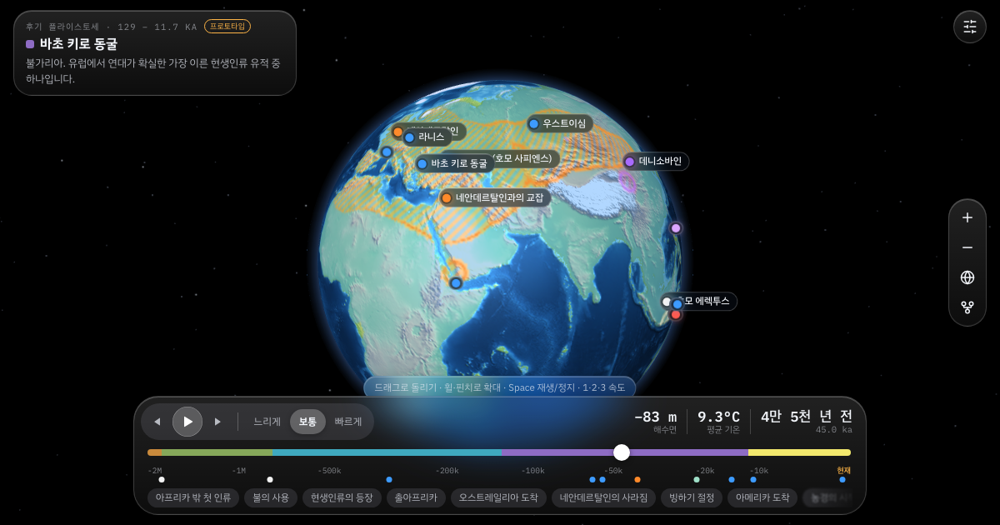

# Human Journey · 인류의 여정

**▶ Live (prototype): https://junhyeopsong.github.io/human-journey/**

[English](#english) · [한국어](#한국어)



---

## English

An interactive 3D globe that follows people across the world over the last 3.3 million years — from Lucy's kind and the first stone tools to us — on an Earth whose coastlines move with ice-age sea level. Built on published dated sites, sea-level and climate records. A sister product of the [Continental Time Machine](https://junhyeopsong.github.io/earth-time-machine/), sharing its design through [time-machine-ui](https://github.com/JunhyeopSong/time-machine-ui).

### Features
- **Travel through 3.3 million years** — a log timeline (linear in settings) with colour bands for each stage, three playback speeds, shortcut chips to key moments, and back/forward buttons that stop at each event. *Follow events while playing* turns to every event as it happens.
- **Ice-age Earth** — coastlines drawn from the sea level of each moment, so land bridges such as Beringia, Sunda and Sahul appear and drown; Northern Hemisphere ice sheets; global mean temperature in °C or °F.
- **Terrain or environment** — show the land by height, or by its biomes at that moment (tropical forest, savanna, desert, steppe, boreal forest, tundra …), so the green Sahara and the ice-age tundra of Europe come and go.
- **17 human species, from dated sites only** — each species' range is a light fill around sites dated to that time, with an outline, and stripes where species overlap. After 50,000 years ago Homo sapiens spreads on foot over the land of each moment from accepted dated sites, never across sea, so islands and continents reached by boat fill only from their own sites.
- **51 events with their evidence** — fossils, tools, art, ancient DNA, farming origins and climate events, each with its date range and sources; disputed claims show both sides, and a setting hides them.
- **Evolution tree** — unfold the event row into a lane per species, with its dated span, its events and the lanes it probably branched from.
- **Globe or world map** — switch to an equal-area (Mollweide) map of the whole world, with continent and ocean names and the land bridges (Beringia, Sundaland, Sahul, Doggerland) that appear when the sea is low; optional polar axis on the globe.
- **Other time machines** — the grid button beside settings switches to the [Continental Time Machine](https://junhyeopsong.github.io/earth-time-machine/), keeping your language.
- **5 languages** — English, 한국어, 日本語, 繁體中文, Español, the same as the Continental Time Machine. Follows your device language, and the language you pick carries over between the two.

### Controls
| Action | Mouse / touch | Keyboard |
|---|---|---|
| Rotate the globe | Drag | Shift + ← → ↑ ↓ |
| Zoom | Scroll / pinch, double-click a spot | + / − |
| Play / pause | ▶ button | Space |
| Step back / forward (stops at each event) | ◀ ▶ buttons | ← → |
| Playback speed | Slow · Normal · Fast | 1 · 2 · 3 |
| Events by species | Species tree button at the end of the event chips | — |

### Data sources
| Data | Source | License |
|---|---|---|
| Sea level | Spratt & Lisiecki (2016), *Clim. Past* — [doi:10.5194/cp-12-1079-2016](https://doi.org/10.5194/cp-12-1079-2016) ([NOAA](https://www.ncei.noaa.gov/access/paleo-search/study/19982)), 0–800 ka; LR04 benthic δ18O stack, Lisiecki & Raymo (2005) — [doi:10.1029/2004PA001071](https://doi.org/10.1029/2004PA001071), for 0.8–3.3 Ma | NOAA open data |
| Relief | ETOPO1 (NOAA NCEI) via [ERDDAP etopo180](https://coastwatch.pfeg.noaa.gov/erddap/griddap/etopo180.html), reduced to 0.25° | Free use and redistribution |
| Rise and fall of the land (glacial isostatic adjustment) | ICE-6G_C (VM5a) paleotopography — Peltier et al. (2015), *J. Geophys. Res. Solid Earth* — [doi:10.1002/2014JB011176](https://doi.org/10.1002/2014JB011176); Argus et al. (2014), *Geophys. J. Int.* — [doi:10.1093/gji/ggu140](https://doi.org/10.1093/gji/ggu140) ([data](https://www.atmosp.physics.utoronto.ca/~peltier/data.php)); every 1,000 years from 26 ka, built by `tools/build_gia.py` | Free for academic and non-commercial educational use, with citation |
| Panama seaway | Schematic before about 2.8 Ma, after O'Dea et al. (2016), *Sci. Adv.* — [doi:10.1126/sciadv.1600883](https://doi.org/10.1126/sciadv.1600883) | Cited research result |
| Ice sheets | Batchelor et al. (2019), *Nat. Commun.* — [doi:10.1038/s41467-019-11601-2](https://doi.org/10.1038/s41467-019-11601-2) ([OSF 7jen3](https://osf.io/7jen3/)), 12 time slices | CC BY 4.0 |
| Biomes (environment map style) | Beyer, Krapp & Manica (2020), *Sci. Data* — [doi:10.1038/s41597-020-0552-1](https://doi.org/10.1038/s41597-020-0552-1), BIOME4 on HadCM3, 0.5°, 72 slices for 0–120 ka, via the pastclim repackaging ([Zenodo 7062281](https://doi.org/10.5281/zenodo.7062281)); Krapp et al. (2021), *Sci. Data* — [doi:10.1038/s41597-021-01009-3](https://doi.org/10.1038/s41597-021-01009-3), 120–800 ka every 4,000 years ([Zenodo 8415273](https://doi.org/10.5281/zenodo.8415273)); 28 classes grouped into 8 by `tools/build_biome.py` | CC BY 4.0 |
| Pliocene biomes (about 3.0–3.3 Ma) | PRISM4 biome land cover — Dowsett et al. (2016), *Clim. Past* — [doi:10.5194/cp-12-1519-2016](https://doi.org/10.5194/cp-12-1519-2016) ([USGS PRISM4 data](https://geology.er.usgs.gov/egpsc/prism/4_data.html)), after Salzmann et al. (2008), *Glob. Ecol. Biogeogr.* — [doi:10.1111/j.1466-8238.2008.00381.x](https://doi.org/10.1111/j.1466-8238.2008.00381.x); 1° | Openly distributed for research; cited |
| Mean temperature | EPICA Dome C, Jouzel et al. (2007), *Science* — [doi:10.1126/science.1141038](https://doi.org/10.1126/science.1141038), scaled to Tierney et al. (2020), *Nature* — [doi:10.1038/s41586-020-2617-x](https://doi.org/10.1038/s41586-020-2617-x); LR04 before 800 ka | NOAA open data |
| Dated sites (species ranges) | Timmermann et al. (2022), *Nature*, Supplementary Table 1 — [doi:10.1038/s41586-022-04600-9](https://doi.org/10.1038/s41586-022-04600-9); ROAD, ROCEEH Out of Africa Database — [Zenodo 7669784](https://doi.org/10.5281/zenodo.7669784); a curated list of published sites with DOIs in `docs/data/sites.json` | CC BY 4.0; CC BY-SA 4.0 → `sites.json` is CC BY-SA 4.0 |
| Events | Published studies, cited in each event and in `docs/data/events.json` | Cited research results |
| 3D rendering · icons | [three.js](https://threejs.org) r128 · [Lucide](https://lucide.dev) | MIT · ISC |

**Notes.** This is a prototype; event dates and summaries are still being reviewed. Sea level and temperature older than 800,000 years are estimates from the LR04 stack, and show the Pliocene warm period (3.3–3.0 Ma) lower and cooler than it was. Ice sheets older than MIS 8 reuse the nearest reconstruction scaled with sea level, and Patagonia is a hand-drawn schematic. The land's rise and fall under the ice uses ICE-6G_C for the last 26,000 years; earlier glacials reuse its Last Glacial Maximum pattern scaled with sea level, so the slow rebound after them is not shown. Biomes between 800,000 and 3 million years ago have no reconstruction and reuse the slice whose sea level is closest (approximate); the Pliocene biome map is on a coarser 1° grid. Plate motion (up to about 200 km over 3.3 million years) is not modelled. The Homo sapiens spread after 50 ka is a model (about 500 km per thousand years from dated sites), and the evolution tree is a rough picture of relationships that are still debated. The data files are built by the scripts in `tools/` (`build_sites.py`, `build_arrival.py`, `build_climate.py`, `build_gia.py`, `build_biome.py`). Japanese, Traditional Chinese and Spanish translations are new and have not been reviewed by native speakers yet. Corrections are welcome.

### Feedback
Found a mistake, have an idea, or want an event added? Email **sapu0000@gmail.com** or [open an issue](https://github.com/JunhyeopSong/human-journey/issues).

### Run locally
```bash
cd docs && python3 -m http.server 8000
```
Then open http://localhost:8000.

---

## 한국어

330만 년 전 루시의 무리와 최초의 석기부터 지금의 우리까지, 빙하기 해수면에 따라 해안선이 바뀌는 지구 위에서 인류가 세계로 퍼져 나간 길을 3D 지구본으로 따라가는 웹 시뮬레이터입니다. 연대가 측정된 유적과 해수면·기후 기록을 바탕으로 만들었습니다. [지구 대륙 타임머신](https://junhyeopsong.github.io/earth-time-machine/)의 자매 제품이며, 공용 디자인 [time-machine-ui](https://github.com/JunhyeopSong/time-machine-ui)를 함께 씁니다.

### 기능
- **330만 년 시간 여행** — 시대별 색 띠가 있는 로그 타임라인(설정에서 선형), 세 가지 재생 속도, 주요 순간으로 가는 바로가기 칩, 사건마다 멈추는 이전·다음 버튼. *재생 중 따라가기*를 켜면 사건이 일어날 때마다 그곳으로 이동합니다.
- **빙하기 지구** — 그 시기 해수면으로 그린 해안선으로 베링기아·순다·사훌 같은 땅다리가 드러났다 잠깁니다. 북반구 빙상, 지구 평균 기온(°C/°F)도 보여줍니다.
- **지형 또는 환경** — 땅을 높낮이로, 또는 그 시기의 바이옴(열대우림·사바나·사막·스텝·북방림·툰드라 등)으로 칠해, 초록 사하라와 빙하기 유럽의 툰드라가 나타났다 사라집니다.
- **연대 유적만으로 그린 17종의 분포** — 종마다 그 시기 연대 유적 주변을 옅은 칠과 외곽선으로, 여러 종이 겹치면 줄무늬로 그립니다. 5만 년 전 이후 현생인류는 인정된 연대 유적에서 그 시기의 육지를 따라 걸어서 퍼지며 바다는 건너지 않으므로, 배로 건너간 섬과 대륙은 그곳의 유적이 있어야 칠해집니다.
- **근거를 갖춘 사건 51개** — 화석·도구·예술·고대 DNA·농경의 기원·기후 사건마다 연대 범위와 출처가 있습니다. 논쟁 중인 주장은 양쪽을 함께 보여주며, 설정에서 숨길 수 있습니다.
- **종별 계통도** — 사건 줄을 펼치면 종마다 칸이 생겨, 유적 연대 범위와 사건, 갈라져 나왔다고 보는 칸이 함께 보입니다.
- **지구본 또는 전체 지도** — 면적이 정확한 몰바이데 세계지도로 바꿀 수 있습니다. 대륙·바다 이름과, 해수면이 낮을 때 드러나는 땅다리(베링기아·순다랜드·사훌·도거랜드) 이름이 보이고, 지구본에서는 자전축을 켤 수 있습니다.
- **다른 타임머신** — 설정 옆 격자 버튼으로 [지구 대륙 타임머신](https://junhyeopsong.github.io/earth-time-machine/)으로 옮겨 갈 수 있고, 언어 설정은 그대로 이어집니다.
- **5개 언어** — 한국어, English, 日本語, 繁體中文, Español으로 지구 대륙 타임머신과 같습니다. 기기 언어를 따르며, 고른 언어는 두 앱 사이에 이어집니다.

### 조작법
| 동작 | 마우스 / 터치 | 키보드 |
|---|---|---|
| 지구 돌리기 | 드래그 | Shift + ← → ↑ ↓ |
| 확대·축소 | 휠 / 핀치, 원하는 곳 더블클릭 | + / − |
| 재생 / 정지 | ▶ 버튼 | Space |
| 이전·다음 (사건마다 멈춤) | ◀ ▶ 버튼 | ← → |
| 재생 속도 | 느리게 · 보통 · 빠르게 | 1 · 2 · 3 |
| 사건을 종별로 펼치기 | 사건 칩 줄 끝의 종별 계통도 버튼 | — |

### 데이터 출처
| 자료 | 출처 | 라이선스 |
|---|---|---|
| 해수면 | Spratt & Lisiecki (2016), *Clim. Past* — [doi:10.5194/cp-12-1079-2016](https://doi.org/10.5194/cp-12-1079-2016) ([NOAA](https://www.ncei.noaa.gov/access/paleo-search/study/19982)), 0–80만 년 전; 80만~330만 년 전은 LR04 해저 산소동위원소 기록, Lisiecki & Raymo (2005) — [doi:10.1029/2004PA001071](https://doi.org/10.1029/2004PA001071) | NOAA 공개 자료 |
| 지형 | ETOPO1 (NOAA NCEI), [ERDDAP etopo180](https://coastwatch.pfeg.noaa.gov/erddap/griddap/etopo180.html), 0.25°로 줄임 | 자유 이용·재배포 |
| 땅의 오르내림 (빙하 지각 평형) | ICE-6G_C (VM5a) 고지형 — Peltier 외 (2015), *J. Geophys. Res. Solid Earth* — [doi:10.1002/2014JB011176](https://doi.org/10.1002/2014JB011176); Argus 외 (2014), *Geophys. J. Int.* — [doi:10.1093/gji/ggu140](https://doi.org/10.1093/gji/ggu140) ([자료](https://www.atmosp.physics.utoronto.ca/~peltier/data.php)); 2만 6천 년 전부터 1천 년 간격, `tools/build_gia.py`로 만듦 | 학술·비상업 교육용 자유 이용, 인용 필수 |
| 파나마 해로 | 약 280만 년 전 이전의 개략도, O'Dea 외 (2016), *Sci. Adv.* — [doi:10.1126/sciadv.1600883](https://doi.org/10.1126/sciadv.1600883) 참고 | 논문 결과 인용 |
| 빙상 | Batchelor 외 (2019), *Nat. Commun.* — [doi:10.1038/s41467-019-11601-2](https://doi.org/10.1038/s41467-019-11601-2) ([OSF 7jen3](https://osf.io/7jen3/)), 12개 시기 | CC BY 4.0 |
| 바이옴 (지도 표현: 환경) | Beyer, Krapp & Manica (2020), *Sci. Data* — [doi:10.1038/s41597-020-0552-1](https://doi.org/10.1038/s41597-020-0552-1), HadCM3 기후에 BIOME4, 0.5°, 0–12만 년 전 72개 시점, pastclim 재가공본([Zenodo 7062281](https://doi.org/10.5281/zenodo.7062281)); Krapp 외 (2021), *Sci. Data* — [doi:10.1038/s41597-021-01009-3](https://doi.org/10.1038/s41597-021-01009-3), 12만–80만 년 전 4천 년 간격([Zenodo 8415273](https://doi.org/10.5281/zenodo.8415273)); `tools/build_biome.py`로 28종을 8개로 묶음 | CC BY 4.0 |
| 플라이오세 바이옴 (약 300만–330만 년 전) | PRISM4 바이옴 — Dowsett 외 (2016), *Clim. Past* — [doi:10.5194/cp-12-1519-2016](https://doi.org/10.5194/cp-12-1519-2016) ([USGS PRISM4 자료](https://geology.er.usgs.gov/egpsc/prism/4_data.html)), Salzmann 외 (2008), *Glob. Ecol. Biogeogr.* — [doi:10.1111/j.1466-8238.2008.00381.x](https://doi.org/10.1111/j.1466-8238.2008.00381.x) 바탕; 1° | 연구용 공개 자료, 출처 표기 |
| 평균 기온 | EPICA Dome C, Jouzel 외 (2007), *Science* — [doi:10.1126/science.1141038](https://doi.org/10.1126/science.1141038), Tierney 외 (2020), *Nature* — [doi:10.1038/s41586-020-2617-x](https://doi.org/10.1038/s41586-020-2617-x)에 맞춰 환산; 80만 년 이전은 LR04 | NOAA 공개 자료 |
| 연대 유적 (종 분포) | Timmermann 외 (2022), *Nature*, 보충표 1 — [doi:10.1038/s41586-022-04600-9](https://doi.org/10.1038/s41586-022-04600-9); ROAD, ROCEEH Out of Africa Database — [Zenodo 7669784](https://doi.org/10.5281/zenodo.7669784); `docs/data/sites.json`에 DOI를 붙인 유적 목록 | CC BY 4.0; CC BY-SA 4.0 → `sites.json`은 CC BY-SA 4.0 |
| 사건 | 공개된 연구, 각 사건과 `docs/data/events.json`에 출처 표기 | 논문 결과 인용 |
| 3D 렌더링 · 아이콘 | [three.js](https://threejs.org) r128 · [Lucide](https://lucide.dev) | MIT · ISC |

**참고.** 프로토타입이며, 사건의 연대와 요약은 검토 중입니다. 80만 년보다 오래된 해수면·기온은 LR04 기록으로 추정한 값이며, 플라이오세 온난기(330만~300만 년 전)는 실제보다 낮고 차갑게 나옵니다. MIS 8보다 오래된 빙상은 가장 가까운 복원을 해수면에 맞춰 쓰며, 파타고니아는 직접 그린 개략도입니다. 빙상 아래 땅의 오르내림은 최근 2만 6천 년은 ICE-6G_C를 쓰고, 그 이전 빙기는 최종 빙기 최성기의 모습을 해수면에 맞춰 줄여 쓰므로 빙기 뒤 천천히 솟아오르는 모습은 빠져 있습니다. 80만~300만 년 전의 바이옴은 복원 자료가 없어 해수면이 가장 비슷한 시점의 분포를 빌려 쓴 근사이고, 플라이오세 바이옴은 1° 격자로 더 거칩니다. 판 이동(330만 년 동안 최대 약 200 km)은 반영하지 않았습니다. 5만 년 전 이후 현생인류의 확산은 연대 유적에서 천 년에 약 500 km씩 퍼진다고 본 모델이고, 종별 계통도의 관계는 학계에서도 논쟁 중인 대략적인 모습입니다. 데이터 파일은 `tools/`의 스크립트(`build_sites.py`, `build_arrival.py`, `build_climate.py`, `build_gia.py`, `build_biome.py`)로 만듭니다. 일본어·번체 중국어·스페인어 번역은 새로 만들어 아직 원어민 검토를 받지 않았습니다. 틀린 부분을 알려주시면 고치겠습니다.

### 피드백
틀린 내용, 아이디어, 추가하고 싶은 사건이 있다면 **sapu0000@gmail.com** 으로 메일을 보내주시거나 [이슈](https://github.com/JunhyeopSong/human-journey/issues)를 남겨주세요.

### 로컬에서 실행
```bash
cd docs && python3 -m http.server 8000
```
브라우저에서 http://localhost:8000 을 엽니다.
